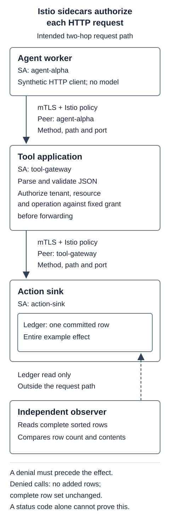

> Draft status: Live policy verification is pending. Checks below describe expected outcomes.

An agent worker needs permission to create a support-ticket follow-up. Istio can restrict which workload calls the tool, using its identity, HTTP method, path, and port. The application still has to check whether that worker may act on the requested tenant and resource.

We'll use an Istio authorization policy to allow one workload identity to call one HTTP operation on a small tool gateway. The gateway checks tenant, resource, and action before asking another service to commit the follow-up. To check enforcement, we'll change the caller, arguments, route, and policy, then inspect the committed rows after each request.

The clients are synthetic and run no model. An accepted request's entire effect is a row in a local SQLite ledger. A test observer reads the ledger independently, so a client error can't hide a committed row.

## Before you begin

Use Linux amd64 with Docker, Istio 1.31.1, kind v0.33.0, and Kubernetes 1.36.4. The intended runtime is a fresh isolated cluster with bounded node logging. Do not apply these manifests to a cluster you already use.

The [local reproduction handoff](/blog/2026/agent-tool-authorization/lab/REPRODUCE.md) links the current immutable public package with its setup and cleanup sequence. Use it to prepare the application and sidecars before applying these policies.

## How the example works

Run the workloads in sidecar mode with separate Kubernetes ServiceAccounts:

| Workload | Service account | Permitted role |
| --- | --- | --- |
| `agent-alpha` | `agent-alpha` | Call the gateway's follow-up route |
| `agent-untrusted` | `agent-untrusted` | No access to that route |
| `tool-gateway` | `tool-gateway` | Validate arguments and call the action sink |
| `action-sink` | `action-sink` | Commit one validated follow-up row |

Istio's [identity and certificate flow](https://istio.io/latest/docs/concepts/security/#identity-and-certificate-management) gives workloads certificates tied to their service identity. The trusted client's principal in this cluster is:


cluster.local/ns/agent-tools/sa/agent-alpha


The policy matches the principal established by peer authentication. Sending `X-Service-Account: agent-alpha` won't change an untrusted client's certificate identity.

Requests go from `agent-alpha → tool-gateway`, then from `tool-gateway → action-sink`. Each connection has its own peer identity: on the second hop, the sink authenticates the gateway. Delegating an end user's authority across that hop would need a separate authenticated contract.

The gateway serves tenant `alpha`. Its server configuration permits resource `ticket-1042` and operation `create_followup`, and it checks those values before forwarding to the sink. The caller's JSON and headers can't grant ownership or permissions.

## Configure peer authentication and gateway authorization

First, require mTLS throughout the namespace, without a port exception:


apiVersion: security.istio.io/v1
kind: PeerAuthentication
metadata:
  name: require-mtls
  namespace: agent-tools
spec:
  mtls:
    mode: STRICT


[`STRICT` peer authentication](https://istio.io/latest/docs/reference/config/security/peer_authentication/) requires mesh mutual TLS. Authorization policies determine which authenticated workloads may invoke the tool.

Next, apply an ALLOW policy with no rules to the gateway:


apiVersion: security.istio.io/v1
kind: AuthorizationPolicy
metadata:
  name: gateway-allow-nothing
  namespace: agent-tools
spec:
  selector:
    matchLabels:
      app: tool-gateway
  action: ALLOW


Add a second ALLOW policy for the permitted operation:


apiVersion: security.istio.io/v1
kind: AuthorizationPolicy
metadata:
  name: gateway-allow-followup
  namespace: agent-tools
spec:
  selector:
    matchLabels:
      app: tool-gateway
  action: ALLOW
  rules:
  - from:
    - source:
        principals:
        - cluster.local/ns/agent-tools/sa/agent-alpha
    to:
    - operation:
        ports: ["8080"]
        methods: ["POST"]
        paths: ["/tools/followups"]


Keep the principal and HTTP operation in the same rule so both must match. Putting them in separate rules would allow either rule to authorize a request.

Without an applicable ALLOW policy, native ALLOW evaluation permits requests unless another policy action denies them. Once an ALLOW policy applies, a request needs at least one matching rule. ALLOW policies are additive, so a broad rule in another policy would widen access despite allow-nothing. An empty rules list matches nothing; an empty rule matches everything. See the [Istio 1.31.1 authorization API](https://github.com/istio/api/blob/1.31.1/security/v1beta1/authorization_policy.proto).

The lab exposes HTTP on workload port 8080 and gives the Kubernetes Service port an HTTP name. Match the destination workload's port in the policy, including when the Service maps a different port to it.

The selector only covers `tool-gateway`. The separate inert witness service should remain reachable over mTLS because it isn't selected. To restrict the whole namespace, use a namespace-wide policy and review every workload it selects.

## Authorize the gateway to call the sink

Apply allow-nothing to `app: action-sink`, then allow the gateway principal to call the effect endpoint:


apiVersion: security.istio.io/v1
kind: AuthorizationPolicy
metadata:
  name: sink-allow-gateway
  namespace: agent-tools
spec:
  selector:
    matchLabels:
      app: action-sink
  action: ALLOW
  rules:
  - from:
    - source:
        principals:
        - cluster.local/ns/agent-tools/sa/tool-gateway
    to:
    - operation:
        ports: ["8080"]
        methods: ["POST"]
        paths: ["/effects"]


Don't give the trusted agent direct permission to call `/effects`: that would bypass the gateway's argument checks. Test both the Service DNS name and the sink Pod IP. The destination proxy should enforce the sink policy at either address.

The sink connection is available to any code running inside the gateway workload, including a compromised gateway. This example doesn't establish protection from cluster administrators, stolen workload credentials, or privileged bypass of traffic interception.

## Validate tool arguments in the gateway

Use this body for the permitted request:


{
  "tenant_id": "alpha",
  "resource_id": "ticket-1042",
  "operation": "create_followup",
  "request_id": "case-valid-01"
}


Istio matches the authenticated caller, method, path, and port. The gateway checks JSON ownership. It requires an object with exactly these four keys, rejects duplicate keys and invalid types, and checks tenant, resource, and operation against its server configuration before making a downstream request.

The gateway should return these responses when it rejects a request:

| Rejection | Gateway response contract |
| --- | ---: |
| Malformed JSON, missing or extra keys, invalid shape or types | 400 |
| Unsupported content type | 415 |
| Body larger than 8 KiB | 413 |
| Valid JSON for another tenant, unowned resource, or disallowed operation | 403 |

For an accepted request, the arguments should reach the sink. The gateway should return 201 only after the sink commits the row and reports success. Use a unique request ID to match each request to its audit and ledger evidence. The fixture handles serial requests; it doesn't implement general idempotency or a concurrent execution protocol.

## Check request enforcement

Live verification is pending, so these are expected outcomes. Start with a permitted request, then repeat it with `tenant_id: beta`. The first request should create one row. The changed tenant should reach the gateway validator, which should reject it without a downstream POST or a new row.

### Workload identity and transport

Send a request from an untrusted client with a valid mesh certificate and forged identity headers. Envoy should deny it before the gateway handler runs. The earlier tenant rejection should happen later, inside the gateway.

Also try a client without a sidecar, deliberately given the trusted ServiceAccount name. Under STRICT mTLS, its request should fail at the transport boundary rather than return HTTP 403. Kubernetes metadata alone doesn't authenticate a network peer. An injected client's `http://` URL doesn't prove plaintext traffic either: its proxy can establish mTLS to the destination proxy.

### Methods, paths, and direct sink access

Try GET, PUT, DELETE, an admin path, and direct sink calls. For each expected denial, compare the ledger count and complete sorted rows before and after. A response status alone could miss a row committed before the error.

The isolated example uses `meshConfig.pathNormalization.normalization: NONE` and compares the literal request target in the gateway. Check trailing slashes, doubled slashes, dot segments, encoded separators, and query strings. Before adapting this configuration, review Istio's [path normalization guidance](https://istio.io/latest/docs/ops/best-practices/security/#understand-path-normalization-in-authorization-policy) alongside your application's router. Disabling normalization isn't a general recommendation.

### Policy revocation

Begin with a permitted call. Remove the gateway's narrow ALLOW policy while leaving allow-nothing in place, and wait until the destination proxy has received the changed configuration. Send a fresh valid request from the same trusted workload.

After propagation, the proxy should deny the request before the gateway runs, leaving the sink unchanged. Restore the exact narrow policy and wait for proxy convergence. A fresh valid request should then succeed and create its matching row, confirming that the request path still works.

Use a fresh HTTP connection for each step. Existing connections and streams remain untested. This checks enforcement after observed policy propagation; it doesn't establish instantaneous revocation, cancellation of an in-flight request, or invalidation of Kubernetes credentials. Deleting a policy in the API server doesn't prove that the data plane has enforced the change.

### Attribute denials and verify committed rows

Use [Envoy access logs](https://istio.io/latest/docs/tasks/observability/logs/access-log/) and the effective proxy configuration to attribute mesh authorization denials. Match public peer-identity metadata to the request without exporting private keys. Application audit records distinguish gateway validation from downstream POSTs.

Read the SQLite ledger through the privileged test observer, separately from the request path. There is no exempt network `/admin` or `/count` route. The observer is lab instrumentation outside the application's authorization model.

After each group of denied requests, make one fresh permitted call and look for its new row. The denied calls should leave the complete row set unchanged; the permitted call should add only its matching row. Without that control, a broken or unreachable sink could look like successful authorization enforcement.

## Conclusion

Istio checks each hop's workload identity, and the gateway validates the arguments before it calls the sink. Reading the committed rows gives you a way to check those decisions even when a request returns an error. Live acceptance is still pending for this lab, which uses real control-plane and sidecar processes with synthetic clients and a local action sink.

`tool-gateway` is the example application. This topology has no Istio ingress gateway or agentgateway, ingress or egress gateway deployment, ambient configuration, model inference, or production workload. The ledger covers serial requests whose entire effect is a committed row. If you add a notification or another provider call, that effect needs its own authorization and recovery handling.
